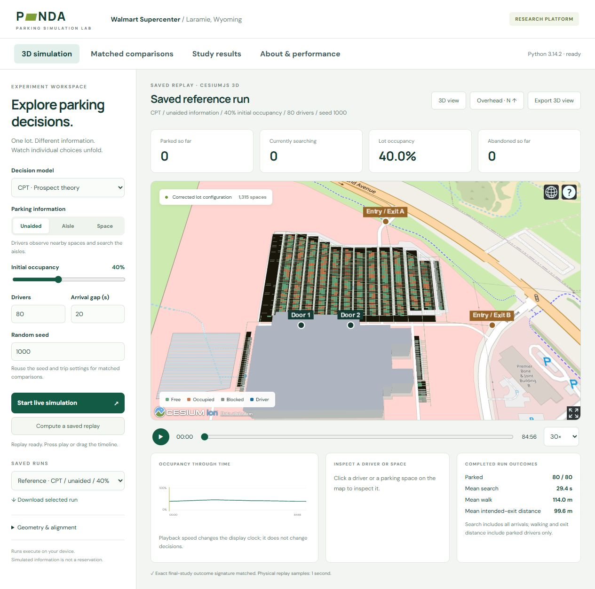
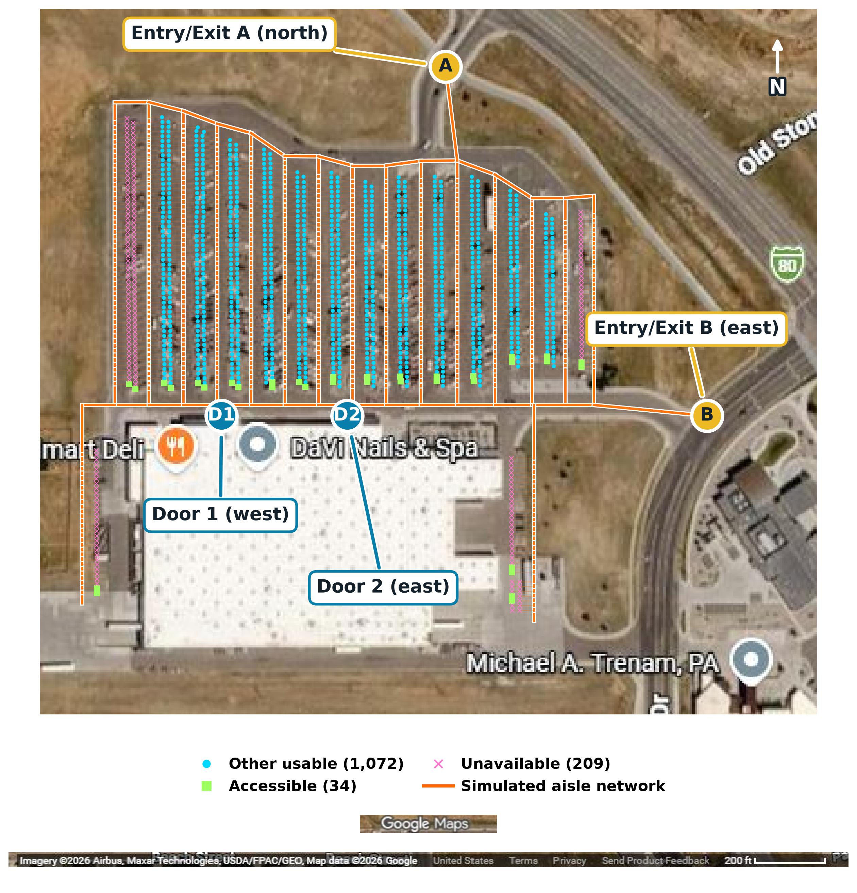
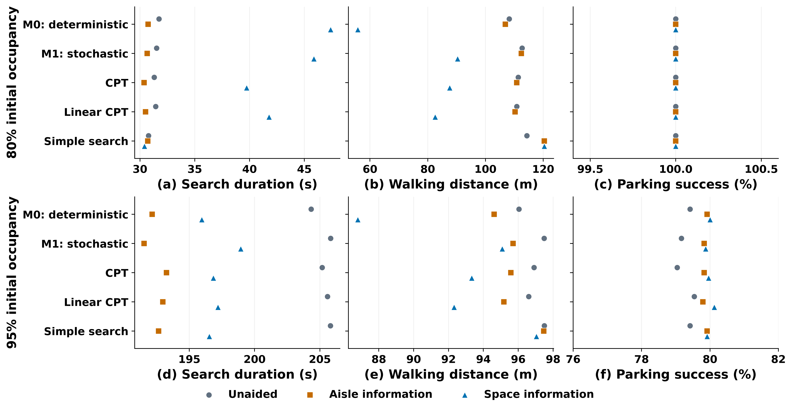

# PANDA-ABM Parking Simulation Platform

Author: Judith Njoku-Vowels

Updated: 3 November 2026

PANDA-ABM was developed as a parking agent-based research simulation using Python and Mesa.

The steps below record how the model was built and checked. They also explain the files, commands and outputs needed to run simulations and examine their results.

## Public website

**[Open the PANDA Parking Simulation Lab](https://panda-abm.vercel.app/)**

The website brings the Python ABM into a georeferenced Cesium 3D environment. Users can change the decision model, information service, initial occupancy, driver count, arrival interval and random seed. The Python simulation runs on the visitor's device through a Pyodide Web Worker.

- **3D simulation:** start a live simulation or calculate a complete replay; inspect drivers, parking spaces and occupancy changes.
- **Matched comparisons:** compare the three information conditions with the same drivers and initial occupancy. Select one to three decision models and 1–30 replications, then download JSON or CSV results.
- **Study results:** inspect the saved research summaries separately from newly generated comparisons.
- **About & performance:** inspect model assumptions, verify the browser engine and measure execution time on the current device.

The 3D scene uses the corrected lot configuration, with building and pavement models providing approximate visual context. It displays simulated conditions. Continuous updates from the physical facility remain future work.

See the [platform guide](dashboard/README.md) for user workflows and the [deployment guide](web/DEPLOYMENT.md) for Vercel configuration. The checked-in release builds without private study archives, a Python backend or a Cesium ion token. Results are held in the browser tab's memory; download them before closing the tab.

## Installation

Run these commands from the repository root in PowerShell:

~~~powershell
python -m venv .venv
./.venv/Scripts/python.exe -m pip install -r requirements.txt -r requirements-analysis.txt
~~~

The first requirements file contains the simulation dependencies. The second adds packages used for post-simulation clustering and stability analysis.

The commands below use python from the selected environment. If the environment is not activated, replace python with ./.venv/Scripts/python.exe.

### Preview the published website locally

With Node.js 22 and Python available, build the checked-in release and serve it from the repository root:

~~~powershell
npm run build
python -m http.server 8768 --bind 127.0.0.1 --directory web/dist
~~~

Open [http://127.0.0.1:8768/](http://127.0.0.1:8768/). This path uses the bundled lot models, corrected configuration, replay and study summaries. It does not require the original model folder or raw experiment archives. The build downloads the pinned browser runtime and verifies its checksums; CesiumJS and the basemap also require internet access.

## Step 1: Core States And Parking Spaces

1. [panda_abm/core/states.py](panda_abm/core/states.py)

   This file defined the driver states used throughout a trip and the parking-space types used by the facility. Shared labels allowed the agent, event logger and analysis code to refer to the same states.

1. [panda_abm/environment/parking_space.py](panda_abm/environment/parking_space.py)

   This file defined the parking-space data and its changing occupancy state. It stored space position, type, restrictions and distance information so that feasibility, movement and choice calculations could use the same space records.

1. [panda_abm/environment/facility.py](panda_abm/environment/facility.py)

   This file generated the small synthetic facility and loaded the Walmart lot configuration. It assembled parking spaces and facility landmarks for use by the model.

1. [panda_abm/environment/coordinates.py](panda_abm/environment/coordinates.py)

   This file converted latitude and longitude into local coordinates measured in metres. The local coordinates were used for movement, visibility and distance calculations within the facility.

The synthetic facility was used for small examples and software checks. The Walmart/PANDA environment was loaded from [data/lot_config.json](data/lot_config.json).

The case study represented the Walmart Supercenter parking lot in Laramie, Wyoming. The store lay south of the main parking area. The main area contained long rows of parking spaces separated by driving aisles, and smaller parking groups extended along the sides of the building.

The configuration contained **1,315 estimated slot records across 17 modules (A–Q)**. Modules A–N accounted for 1,245 records, and the side groups O–Q accounted for 70. Of all records, 34 were marked accessible and 209 were marked blocked/unavailable, leaving 1,106 unblocked records before initial occupancy and driver-specific restrictions were applied. These counts described the simulation configuration, rather than a surveyed inventory of usable spaces.

Slot coordinates were aligned to satellite imagery and reviewed visually. The layout and aisle network remained estimates. Four landmarks were included:

- Door 1 and Door 2: the western and eastern doors along the parking-facing store wall.
- Entry/Exit A: the northern driveway. Entry/Exit B: the eastern driveway at Vista Drive. Both were treated as allowing entry and exit.

The map shows the corrected space coordinates and simulated aisle network. Satellite image: Google Maps, with branding and imagery attribution retained.

Each slot was assigned separate distances to Door 1, Door 2, Entry/Exit A and Entry/Exit B. These were stored as distance_to_door_1_m, distance_to_door_2_m, distance_to_exit_a_m and distance_to_exit_b_m. They represented straight-line distances; vehicle movement followed the aisle network.

To recalculate the distance fields after editing the landmarks or slot coordinates:

~~~powershell
python scripts/update_lot_distances.py
~~~

## Step 2: Driver Attributes, Preferences And Populations

1. [panda_abm/behavior/population.py](panda_abm/behavior/population.py)

   This file defined driver attributes and population specifications. Each specification held the arrival time, destination, vehicle characteristics, familiarity, eligibility, permit status and walking constraints needed to recreate a driver.

1. [panda_abm/behavior/parameters.py](panda_abm/behavior/parameters.py)

   This file held the utility weights, acceptance threshold and response temperature. The weights represented the importance of walking, price, search, rule risk, availability, familiarity, guidance, compliance and exit proximity when evaluating an offer.

1. [panda_abm/behavior/references.py](panda_abm/behavior/references.py)

   This file defined expected walking, search and exit-distance reference points. These expectations provided the comparison levels used when CPT evaluated outcomes as gains or losses.

1. [panda_abm/behavior/cpt_parameters.py](panda_abm/behavior/cpt_parameters.py)

   This file defined CPT value curvature, loss aversion and probability-weighting parameters. It also recorded parameter-source information so that literature benchmarks and simulation assumptions could be distinguished.

1. [panda_abm/behavior/continuous.py](panda_abm/behavior/continuous.py)

   This file sampled continuous driver preferences, attributes and constraints with reproducible random streams. The resulting population could vary in tastes and expectations while preserving the same sampled drivers across matched experiments.

1. [panda_abm/behavior/factory.py](panda_abm/behavior/factory.py)

   This file provided the entry points for creating reproducible populations and controlled comparison populations. It connected population specifications, behavioral parameters and reference points to the driver setup used by the simulation.

Population specifications can be saved and reused so that different decision models and information conditions receive the same drivers.

## Step 3: Perception, Information And Choice Sets

1. [panda_abm/environment/perception.py](panda_abm/environment/perception.py)

   This file determined which spaces a driver could observe locally and recorded their perceived availability. It also provided individual-space reports for the space-information condition, allowing reported targets beyond local visibility to enter consideration.

1. [panda_abm/environment/information.py](panda_abm/environment/information.py)

   This file calculated compatible free-space counts by aisle and used those counts to guide exploration. It supplied aisle-level information without revealing the identities of distant free spaces to the driver.

1. [panda_abm/environment/choice_set.py](panda_abm/environment/choice_set.py)

   This file filtered observed or reported spaces into the offers a driver could consider. The checks covered perceived availability, vehicle compatibility, accessibility eligibility, reserved-space permission and walking-distance limits.

Three information conditions were implemented:

| Command-line value | Driver information and search behavior |
|---|---|
| unaided | Observe nearby spaces and explore the parking aisles |
| aisle | Receive compatible free-space counts by aisle; use them to guide exploration when local offers are declined |
| space | Receive individual current-space reports and consider targets beyond local visibility |

Reports described occupancy at the time they were received. Drivers still travelled to a chosen space and attempted a claim on arrival. A free-space report did not reserve the space.

Select the information condition with `--information-mode`.

## Step 4: Decision Models

The decision models were implemented in [panda_abm/behavior/decision](panda_abm/behavior/decision).

### M0: Deterministic Utility

The deterministic model selected the feasible space with the highest utility, subject to the acceptance threshold.

Implementation: [panda_abm/behavior/decision/deterministic.py](panda_abm/behavior/decision/deterministic.py).

### M1: Stochastic Utility

The stochastic utility model used softmax choice probabilities. Higher-utility spaces were more likely to be selected; the sampled offer was checked against the acceptance threshold.

Implementation: [panda_abm/behavior/decision/random_utility.py](panda_abm/behavior/decision/random_utility.py).

### CPT: Cumulative Prospect Theory

The CPT model evaluated parking success/failure prospects relative to reference points. It applied value curvature, loss aversion and cumulative probability weights, compared parking with continuation, and used a softmax response rule.

Implementation: [panda_abm/behavior/decision/cpt.py](panda_abm/behavior/decision/cpt.py). Parameter-source information is recorded in [panda_abm/behavior/cpt_parameters.py](panda_abm/behavior/cpt_parameters.py).

Shared feature construction, units and normalization were defined in [panda_abm/behavior/decision/transforms.py](panda_abm/behavior/decision/transforms.py).

### Research comparison controls

The linear-CPT control removes nonlinear value and probability transformations while retaining the reference comparison, acceptance and continuation rules. It is implemented alongside CPT in [panda_abm/behavior/decision/cpt.py](panda_abm/behavior/decision/cpt.py).

The simple-search control chooses the feasible local space with the shortest estimated approach. It considers reported remote spaces when no feasible local space is available. Its implementation is in [panda_abm/simulation/tcss_conditions.py](panda_abm/simulation/tcss_conditions.py).

The website exposes the three primary decision models. The two additional controls are used by the research experiment scripts.

## Step 5: Aisle Search, Movement And Timing

[panda_abm/environment/navigation.py](panda_abm/environment/navigation.py) built a connected aisle network from the estimated parking geometry. It connected main aisles, side corridors, access points and individual stalls.

[panda_abm/core/agent.py](panda_abm/core/agent.py) defined the individual driver agent and managed movement, observations, offer evaluation and parking attempts. It tracked elapsed search, resumed exploration after failed claims, and advanced drivers through walking, dwell, return and departure. The implemented trip sequence was:

~~~text
Arrival -> Search -> Target approach -> Parking claim
                         |
                    Failed claim -> Resume search

Successful parking -> Walk to destination -> Dwell
                   -> Return to vehicle -> Release space -> Exit

Search deadline reached -> Abandon search
~~~

[panda_abm/core/model.py](panda_abm/core/model.py) assembled the Mesa simulation from the facility, population, decision model, information service, resource manager and event logger. It managed the clock and driver activation, applied initial occupancy, and recorded system snapshots during each run.

Timing controls were separated:

| Setting | Purpose |
|---|---|
| integration_seconds | Physical update resolution |
| decision_interval_s | Time between search decisions |
| step_seconds | Output/snapshot interval |
| parking_maneuver_s | Duration included in a parking attempt |
| max_search_time_s | Elapsed search deadline |

Search time was measured from search start to parking or abandonment. It included travel, unsuccessful attempts and maneuver time. Walking used straight-line distance; vehicle travel followed the inferred graph.

## Step 6: Events, Parking Claims And Metrics

1. [panda_abm/core/events.py](panda_abm/core/events.py)

   This file recorded the simulation event stream, including arrivals, observations, candidate evaluations, selected targets, parking attempts, successful claims, releases, abandonment and state changes. Those events supplied the evidence used to reconstruct outcomes and decisions.

1. [panda_abm/core/resource_manager.py](panda_abm/core/resource_manager.py)

   This file handled parking-space claims and releases. It enforced single occupancy and recorded whether a driver successfully claimed a target or lost it before arrival.

1. [panda_abm/metrics/collector.py](panda_abm/metrics/collector.py)

   This file converted simulation events into driver outcomes, system snapshots, candidate-decision records and trajectories. It retained identifiers and timing information so that summaries could be traced back to individual runs and drivers.

1. [panda_abm/analysis/plots.py](panda_abm/analysis/plots.py)

   This file produced the standard experiment figures for search time, walking distance, chosen spaces and occupancy over time. Dedicated study scripts produced the matched-comparison and behavioral-profile figures.

1. [panda_abm/simulation/runner.py](panda_abm/simulation/runner.py)

   This file ran the selected decision models across repetitions and saved the outputs. It connected the facility, population, simulation settings, metric collection, summary tables, standard plots and JSON exports.
## Step 7: Run The Synthetic Demo

Start with the small synthetic environment to check the simulation-to-output pipeline:

~~~powershell
python scripts/run_demo.py --output results/demo_research
~~~

The demo was configured to run the decision models and write metrics, plots, event logs and JSON exports.

## Step 8: Run A Walmart/PANDA Experiment

Load the facility through --facility-config and select the population size, initial occupancy, repetitions and information condition.

Example baseline:

~~~powershell
python scripts/run_experiment.py --facility-config data/lot_config.json --scenario-id walmart_baseline --population-size 48 --initial-occupancy-rate 0.35 --repetitions 10 --information-mode unaided --output results/walmart_baseline
~~~

Example crowded-lot condition:

~~~powershell
python scripts/run_experiment.py --facility-config data/lot_config.json --scenario-id walmart_crowded --population-size 80 --initial-occupancy-rate 0.80 --repetitions 10 --information-mode unaided --output results/walmart_crowded
~~~

Use --information-mode aisle or --information-mode space to run either information service. Use --seed to set the base random seed.

List all available options:

~~~powershell
python scripts/run_experiment.py --help
~~~

The general runner holds its generated population fixed across repetitions while changing the simulation seed. Dedicated study scripts below define their own replication and matching procedures.

## Step 9: Run Matched Information Comparisons

The dedicated information study compares all three information conditions within each decision model and occupancy level.

~~~powershell
python scripts/compare_parking_information.py --output results/information_reproduction
python scripts/report_parking_information.py --output results/information_reproduction
~~~

The comparison script followed these steps:

1. Generated and saved a population for each seed.
2. Reused it across the information conditions and decision models.
3. Matched the initial occupied-space IDs within each occupancy condition.
4. Ran the simulations and recorded checks, events and outcomes.
5. Saved per-driver and per-run data for paired comparisons.

The report script created summary tables, paired seed-level intervals, competition diagnostics and figures.

The illustration shows the three primary models and the linear-CPT and simple-search controls at 80% and 95% initial occupancy. Markers show condition means; search includes all arrivals, while walking includes parked drivers. The figure comes from the versioned study, which included the two additional controls. The [figure data and provenance](assets/readme/README.md) are included in the repository.

A smaller custom run:

~~~powershell
python scripts/compare_parking_information.py --output results/information_small --seeds 1100 1101 1102 --occupancies 0.8 0.95 --size 40 --workers 2
python scripts/report_parking_information.py --output results/information_small
~~~

Frozen study runners reject an existing design file. Use a fresh output folder for a new experiment.

## Step 10: Population And Behavioral-Profile Analysis

[panda_abm/behavior/continuous.py](panda_abm/behavior/continuous.py) generates continuous driver preferences and constraints. [panda_abm/analysis/response_profiles.py](panda_abm/analysis/response_profiles.py) examines patterns in how those drivers respond to controlled parking choices.

The final profile analysis includes every driver, including those who did not park. Profiles are fitted to decision responses before parking success and information benefits are compared between groups. These are exploratory, model-specific response groups, not validated categories of real drivers.

With the verified primary study archive at `results/tcss_first_batch_20261028/`, run:

~~~powershell
python scripts/analyze_all_driver_profiles.py
python scripts/verify_all_driver_profiles.py
python scripts/report_all_driver_profiles.py
~~~

The analysis uses training and held-out seeds, checks grouping stability and preserves the source hashes. Its outputs are written to `research/tcss/all_driver_profiles_20261102/`, and the reporting script creates tables and figures in `paper/all_driver_profiles_20261102/`. These generated archives are not included in the website release.

The earlier continuous-population campaign remains available in `scripts/run_continuous_population_study.py` and `scripts/analyze_continuous_population.py`. Its outputs belong to that campaign and should not be pooled with the final study.

## Step 11: Model Verification And Stress Testing

The model was checked in stages during development: automated tests covered individual rules, stress tests examined demanding conditions, and audits examined decision mechanisms and availability beliefs. These checks assess the simulation's implementation and assumptions; they do not replace comparison with observed driver behavior.

### Automated tests

Run the test suite before starting experiments:

~~~powershell
python -m pytest tests -q
~~~

The tests check parking restrictions, decision calculations, search timing, occupancy claims, information handling and population generation.

### Development audits

Use a fresh output folder and pass the same folder to all five commands below. The first four scripts generate the audit data; the last script assembles the report.

**Simulation checks:** examine repeatability, timing, parking rules and sensitivity to model settings.

~~~powershell
python scripts/publication_stress_audit.py --output results/audit_reproduction
~~~

**Crowded-lot stress tests:** extend the checks to higher demand and longer shopping stays.

~~~powershell
python scripts/publication_pressure_audit.py --output results/audit_reproduction
~~~

**Decision-mechanism checks:** examine how behavioral assumptions affect decisions and test whether profile analysis can find groups in data that contain no distinct driver types.

~~~powershell
python scripts/publication_mechanism_audit.py --output results/audit_reproduction
~~~

**Availability-belief checks:** compare the assumed chance of acquiring a space with claim outcomes inside the simulation.

~~~powershell
python scripts/publication_claim_calibration.py --output results/audit_reproduction
~~~

**Audit report:** combine the checks, tables and figures. This report also recalculates walking summaries from the earlier continuous-population study. It requires that study at `results/continuous_population_20261027/`, or its `model_summary.csv` and `drivers.csv` copied into `results/audit_reproduction/historical_inputs/`. These files are needed for the report's historical correction, not for the four audit commands above.

~~~powershell
python scripts/report_publication_audit.py --output results/audit_reproduction
~~~

### Versioned research experiments

Later experiments extended the audit work to matched information comparisons and operating conditions:

- [scripts/verify_tcss_mechanisms.py](scripts/verify_tcss_mechanisms.py) independently checks utility and CPT calculations before an experiment batch.
- [scripts/run_tcss_first_batch.py](scripts/run_tcss_first_batch.py) compares the primary models, linear-CPT control and preference-variation controls.
- [scripts/report_tcss_first_batch.py](scripts/report_tcss_first_batch.py) checks the saved archive and calculates paired summaries.
- [scripts/run_tcss_robustness.py](scripts/run_tcss_robustness.py) examines simple search, mixed information adoption, delayed reports, background departures, a synthetic layout and simulation time steps.
- [panda_abm/simulation/tcss_conditions.py](panda_abm/simulation/tcss_conditions.py) implements those additional conditions.

These campaign scripts use the versioned documentation and control archives specified in their source files. The full research archive is separate from the website release. For new comparisons, use Step 9 or the website. Saved primary-study summaries are included in [web/release/study-results.json](web/release/study-results.json).

## Step 12: Digital-Twin And Cesium Exports

[panda_abm/export/json_exporter.py](panda_abm/export/json_exporter.py) exported simulated events and trajectories. [panda_abm/twin/state.py](panda_abm/twin/state.py) built space, vehicle and system-state snapshots.

The general experiment runner saved:

~~~text
twin_exports/     Vehicle trajectories
event_exports/    Event streams
state_exports/    Final simulation states
~~~

The [platform guide](dashboard/README.md) explains the website workflows. The files below connect the Python simulation to the Cesium scene and browser controls.

See [web/DEPLOYMENT.md](web/DEPLOYMENT.md) for release preparation and deployment. Rebuilding research assets requires the original study archives and prepared model files.

The browser-facing implementation is organized as follows:

- [dashboard/app.js](dashboard/app.js) renders the georeferenced lot, driver positions, replay controls and occupancy changes in Cesium.
- [dashboard/platform.js](dashboard/platform.js) manages scenario requests, matched comparisons, study summaries, downloads and device tests.
- [dashboard/engine/client.js](dashboard/engine/client.js) sends requests to the simulation worker and supports cancellation.
- [dashboard/engine/worker.js](dashboard/engine/worker.js) initializes Pyodide, verifies the Python bundle and invokes the existing ABM.
- [panda_abm/twin/replay.py](panda_abm/twin/replay.py) advances live simulations and records complete replays with timestamped states.
- [panda_abm/twin/platform.py](panda_abm/twin/platform.py) completes simulations, summarizes outcomes and calculates matched information effects.
- [web/build.mjs](web/build.mjs) verifies the release against the source and builds the static website, including the 3D models and pinned runtime assets.

[scripts/benchmark_public_platform.py](scripts/benchmark_public_platform.py) creates native verification fixtures and repeated timing measurements. [scripts/verify_platform_comparison.py](scripts/verify_platform_comparison.py) checks a downloaded browser comparison against native execution. Selected implementation evidence is included in [web/release/evaluation/REPORT.md](web/release/evaluation/REPORT.md). Device execution times describe the tested workload and do not establish field accuracy or general server capacity.

The separate [panda_abm/forecasting](panda_abm/forecasting) package provided forecast-provider hooks. The provider named PerfectForecastProvider reported current occupancy; it did not predict future availability. The current-information comparison used the information modes described in Step 3.

## Output Folders

The general experiment runner wrote:

~~~text
<output>/
  raw/
    events/events.csv
    agents/agent_metrics.csv
    system/system_metrics.csv
    decision_log.csv
    trajectories/trajectories.csv
  tables/model_comparison.csv
  figures/
  twin_exports/
  event_exports/
  state_exports/
~~~

The dedicated information study wrote:

~~~text
<output>/
  design.json
  source_snapshot.zip
  populations/
  initial_occupancy/
  replications/
  drivers.csv
  runs.csv
  checks.json
~~~

Reporting added summary and paired-comparison tables, figures, REPORT.md, package versions and a reproducibility bundle to the same directory.

The [README illustration index](assets/readme/README.md) records the source and provenance of the images displayed here.

## Main Metrics

[panda_abm/metrics/collector.py](panda_abm/metrics/collector.py) derives metrics from logged events. The output folders above contain driver records and experiment summaries.

### Driver Outcomes

| Field | Meaning and unit |
|---|---|
| parked, abandoned | Whether the driver successfully parked or abandoned the search. Parking success was established by a ParkingStarted event. |
| search_time | Elapsed seconds from search start to parking or abandonment, including aisle travel, target approach, failed claims and maneuver time. |
| search_started_s, search_ended_s, parking_time_s | Simulation timestamps in seconds, retained to check the timing of each outcome. |
| search_distance | Vehicle distance travelled during search and approach, measured in metres. |
| walking_distance | Straight-line distance in metres from the chosen space to the driver's destination door. It was recorded only for drivers who parked. |
| chosen_space, chosen_module | Identifiers of the successfully selected stall and its parking module. These were left missing for unsuccessful drivers. |
| rejected_spaces, candidate_evaluations | Counts of rejected offers and evaluated candidates. These described decision activity, rather than distinct visited stalls. |
| module_switches | Number of recorded changes between parking modules during search. |
| lost_space_events | Number of failed claims where a target could not be secured. |
| violation | Recorded indicator of a parking-rule violation. |
| utility_of_chosen_action | Model-specific value recorded for the chosen action. Its scale depended on the decision model. |
| information_reports_received | Number of information reports received during the trip. |
| information_route_changes | Number of recorded exploration-route changes under the information service. |
| remote_targets_selected | Number of targets selected beyond local visibility using individual-space information. |

Run identifiers, scenario, seed, replication, driver ID, decision model and information condition accompanied the outcomes. Driver preferences, reference points and CPT parameters were also retained to relate observed decisions to the sampled inputs.

### System And Decision Records

System snapshots recorded occupied_spaces, usable_spaces, occupancy_rate, active_searchers, targeting_agents, parked_agents and abandoned_agents at timestep_s. Occupancy described the facility state, including initially occupied spaces; it differed from the success rate of the arriving study drivers.

The decision log recorded each evaluated space, its feasibility, utility, selection probability and chosen indicator. Trajectories recorded time, driver state, local x/y coordinates, selected space and candidate IDs. These records allowed search routes and individual decisions to be inspected alongside the aggregate metrics.

### Summary And Comparison Metrics

The general summaries reported success rate, abandonment rate, mean/median/90th-percentile search time, mean walking distance, mean search distance and mean rejected offers. Search summaries included all arriving drivers with recorded outcomes; walking summaries included only parked drivers because unsuccessful walking distances were missing.

The matched information report also separated search time for all arrivals from search time among parked drivers. It reported intended-exit distance among parked drivers, failed claims per driver, selected-space agreement, target competition, and outcomes by mobility constraints, destination door and intended exit. Exit distance represented straight-line proximity to the intended access point, rather than the time required to drive out.

Paired contrasts were calculated as differences within matched seeds, with 95% seed-bootstrap intervals. Walking and exit-distance contrasts were conditional on parking, so they were interpreted alongside success and abandonment rather than as outcomes for every arrival.
