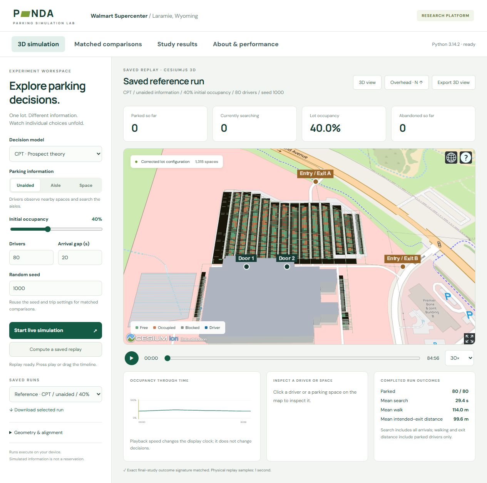

# PANDA Parking Simulation Lab

**[Open the published website](https://panda-abm.vercel.app/)**



The public platform combines a Cesium 3D scene, interactive simulations,
matched information comparisons and saved study results. The original Python
ABM executes in a Pyodide Web Worker on the visitor's device. The website
changes how experiments are requested and displayed; it does not rewrite
parking decisions in JavaScript.

## Supply and traffic extension

Exact empty-space counts, map selections, live closures and reopening, scheduled background departures, driver routes and an optional aisle-traffic model are described in [the supply and traffic guide](SUPPLY_TRAFFIC.md). The traffic mode is experimental; archived research results retain their original movement model.

## End-user workflow

1. **3D simulation:** choose deterministic utility, stochastic utility or CPT;
   choose information, occupancy, arrivals, driver count and seed. Start a live
   simulation or compute a complete replay. Inspect drivers and spaces, switch
   between 3D and north-up views, and download the replay or a scene image.
2. **Matched comparisons:** choose one to three models and 1–30 replications.
   All three information conditions use the same generated population and
   initial occupancy for each seed. The platform checks matching fingerprints.
   Download driver outcomes and provenance as JSON, or aggregate estimates as CSV.
3. **Study results:** inspect the saved primary 30-replication experiments.
   These summaries retain their own provenance and are separate from new trials.
4. **About & performance:** read assumptions and run device-side verification
   and performance tests. Download the measurements for independent analysis.

Search and success metrics include every arrival. Walking and intended-exit
proximity include parked drivers. Paired combined-time differences include only
those parked in both conditions and use a walking speed of 1.4 m/s. Intervals
resample whole matched replications 10,000 times; they are exploratory pointwise
95% percentile intervals with no multiplicity correction. One replication does
not produce an uncertainty interval. Runs are held in the tab's memory; download
results before closing it. At most four newly computed replays are retained.

## Preview the published website locally

Install Node.js 22. From the repository root, build the checked-in release and serve the static output with Python:

```powershell
npm run build
python -m http.server 8768 --bind 127.0.0.1 --directory web/dist
```

Open [http://127.0.0.1:8768/](http://127.0.0.1:8768/). The release includes the two lot models, corrected configuration, saved replay, study summaries and verification fixtures. No original model folder, research archive, Python simulation server or Cesium ion token is required for this preview.

The build downloads pinned Pyodide 314.0.7 runtime assets and checks their SHA-256 digests. CesiumJS and the OpenStreetMap basemap also need internet access. Native Python dependencies are required for command-line ABM experiments, not for browser-side simulation. Mesa 3.5.1, NetworkX 3.7 and tqdm 4.70.1 are included in the tested browser bundle; runtime versions are recorded in downloads.

For release regeneration after code changes, follow [web/DEPLOYMENT.md](../web/DEPLOYMENT.md). That separate workflow requires the prepared research archives and model assets. The legacy loopback server in `scripts/serve_dashboard.py` remains a developer API/replay utility; the public website executes the ABM in its worker.

## Implementation and reproducibility

- `dashboard/app.js` renders corrected space coordinates, movement and occupancy.
- `dashboard/platform.js` manages end-user workflows, exports and browser tests.
- `dashboard/engine/client.js` manages worker requests and cancellation.
- `dashboard/engine/worker.js` loads the Python source and invokes existing
  replay/live functions or the comparison adapter.
- `panda_abm/twin/platform.py` completes trips and summarizes paired comparisons.
  Decision, search, movement and occupancy rules remain in the existing model.
- `scripts/build_public_platform.py` copies an explicit public-file allowlist,
  bundles source and dependency licenses, and records source/runtime hashes.
- `scripts/benchmark_public_platform.py` creates native verification fixtures
  and repeated full-lifecycle timings for 20, 80 and 120 drivers.
- `scripts/verify_platform_comparison.py` checks a browser-exported comparison
  against native execution, including every driver and paired estimates.
- `web/release/evaluation/` contains selected verification records and timing evidence included with the release.

For native measurements run `python scripts/benchmark_public_platform.py`.
For browser measurements use the performance button while keeping the tab
visible. Record viewport and software versions. Run native and browser timing
experiments sequentially to avoid competing test workloads. Device measurements
do not establish server capacity, mobile performance, field accuracy or usability.

## Geometry and scope

The estimated configuration contains 1,315 records, 1,106 usable spaces and
34 accessible designations. Corrected JSON coordinates determine simulated
space positions, doors and vehicle accesses. Building and pavement GLBs are
approximate context: the retained similarity fit has 3.240 m RMS residual and
13.135 m maximum residual. The GLBs use explicit Y-up/X-forward loading to match
that transform. `dashboard/alignment.json` records the fit and config hash.

The platform supports scenario-based decision support. It does not continuously
assimilate observed occupancy or validate assumed behavior against field data.
See [THIRD_PARTY.md](THIRD_PARTY.md) for dependencies and map attribution.

## Simulation duration and pause

The sidebar supports 10-, 20-, 30- and 60-minute simulation windows, a custom 1–120-minute window, or full trips. Pause/Resume stops and continues the same live model. Window duration does not change a driver's 600-second search budget. At a cutoff, unfinished searches remain distinct from abandonments. Population size and arrival interval determine how many drivers arrive. See [SUPPLY_TRAFFIC.md](SUPPLY_TRAFFIC.md) for cutoff metrics and controls.

## Multiple environments

Select Walmart or the synthetic transfer layout, or import a lot JSON and self-contained GLB models. Imported lots include explicit aisle connections and currently require two doors and two paired vehicle access points. Validate the layout, adjust the visual model alignment and confirm the preview before simulating. Download the environment configuration and retain the original GLBs; imported files stay in the current tab. See [ENVIRONMENTS.md](ENVIRONMENTS.md) for the workflow, JSON fields and limits.

## Vehicle animation

Generated drivers use original lightweight GLB vehicle models: compact, sedan, SUV, van or pickup, selected from their ABM vehicle type. Models have different metre-scale dimensions and remain visible while parked during the walking/activity stages. They follow recorded positions during search and departure. Press play on a saved replay or start live execution; zoom in or follow a driver for detail. These are stylized vehicle meshes, not photorealistic car assets. Visual dimensions do not change the optional traffic model's common 4.5-m vehicle length or make it calibrated against observed traffic. Background occupancy remains colored space markers, not individually moving cars.


New simulations animate actual within-tick route corners and show directional lane lines when traffic is enabled. The congestion panel reports aisle episodes, duration, peak queued vehicles and modeled causes; **Download congestion CSV** exports the records. Traffic is selected by default for new interactive scenarios. The archived reference replay and Python default remain unchanged. See [SUPPLY_TRAFFIC.md](SUPPLY_TRAFFIC.md) for definitions and limits.


## Walking drivers

**Show walking drivers** displays a pedestrian for each driver walking to the assigned door and returning to the parked car. The car stays in its space during the activity. Select a driver and enable **Follow selected driver** to inspect the trip, preferably at 1× playback. The pedestrian animation uses existing walking timestamps and straight-line distances; it does not add a sidewalk network or pedestrian–vehicle interactions. New recordings include explicit walking intervals, while older replays use their recorded state transitions.


Camera follow uses the driver selected in the dropdown even when another parking space is inspected. Enabling it brings the map into view and centers a close camera on the vehicle or walking pedestrian; during the activity it stays near the assigned door. Follow starts once a future driver arrives and reports when a driver has left. Unchecking follow releases the camera. The 3D/overhead overview buttons also exit follow mode. Camera positioning does not depend on a model asset finishing its bounding-sphere load.
